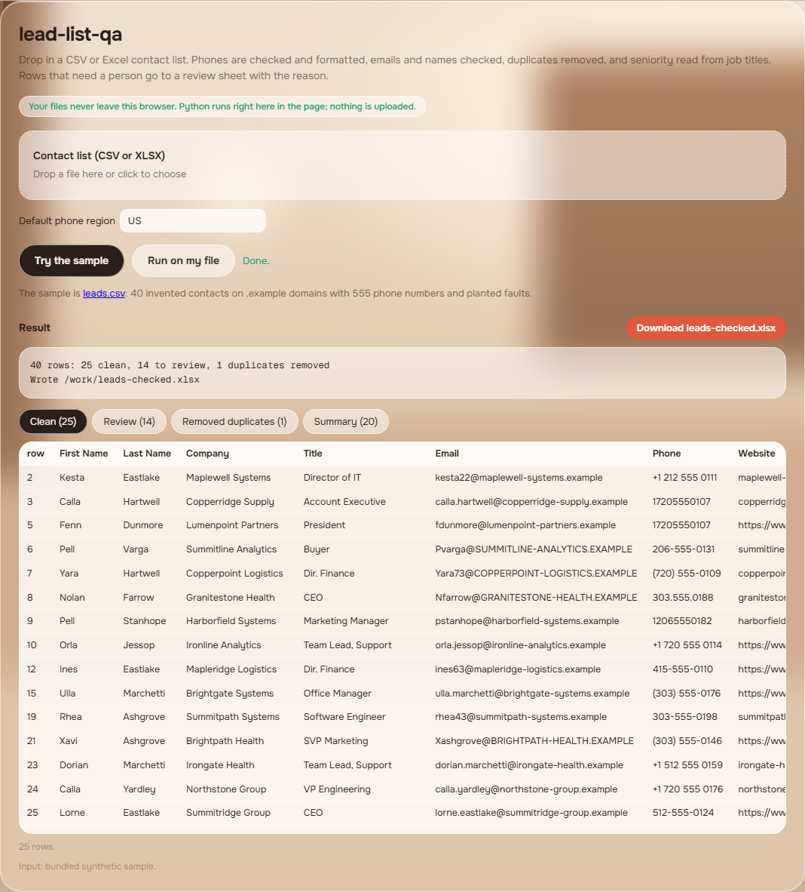

# lead-list-qa

[](https://github.com/chasebuilds/lead-list-qa/actions/workflows/ci.yml)  [](LICENSE)

**[Live demo: try it in your browser](https://chasebuilds.github.io/lead-list-qa/)**. Drop in your own file or run the bundled sample with one click. The real package runs in the page with Pyodide, so files never leave your browser.

[](https://chasebuilds.github.io/lead-list-qa/)

Checks a B2B contact list (CSV or Excel) before outreach. Each row gets a score out of 100 and the reasons behind it. Rows with no problems go to a Clean sheet, rows with problems go to a Review sheet, and repeats of the same person go to a Removed duplicates sheet. Everything runs offline: no email verification service, no sending, no scraping, no API keys.

## Measured result

Fake contact lists with planted faults were run through the tool and scored. The table below is written by the benchmark script from a real run, not typed by hand. Method and limits: [BENCHMARK.md](BENCHMARK.md).

<!-- benchmark:start -->
| Measure | Result |
|---|---:|
| Rows | 5,000 |
| Caught: `email_syntax` | **100.0%** (196 of 196) |
| Caught: `role` | **100.0%** (185 of 185) |
| Caught: `disposable` | **100.0%** (180 of 180) |
| Caught: `freemail` | **100.0%** (187 of 187) |
| Caught: `phone` | **100.0%** (207 of 207) |
| Caught: `missing` | **100.0%** (178 of 178) |
| Caught: `dup_email` | **100.0%** (207 of 207) |
| Caught: `dup_name` | **100.0%** (191 of 191) |
| Caught: all planted faults | **100.0%** (1,531 of 1,531) |
| Clean rows flagged by mistake | **0.0%** (0 of 3,469) |
| Title bucket right on clean rows | **100.0%** (3,469 of 3,469) |
<!-- benchmark:end -->

These are planted faults the checks were written for, so a high catch rate is expected. The useful numbers are the false flags on clean rows and the title buckets. [LIMITATIONS.md](LIMITATIONS.md) lists what the tool cannot see, starting with the big one: it does not prove an inbox exists.

## What it checks

| Check | Example | Score cost |
|---|---|---:|
| Email syntax (RFC-lite) | `jo..ann@acme.example`, `bob@acme`, `two@@signs.example` | 60 |
| Disposable domain (small bundled list) | `x@mailinator.com` | 50 |
| Missing required field (email, first name, last name, company) | blank company | 30 each |
| Role address | `info@`, `sales@`, `support@` | 25 |
| Free-mail address for a company contact | `jane@gmail.com` | 15 |
| Bad phone (parsed with `phonenumbers`, region US unless the number has a `+` code) | `555-0142`, `12345` | 15 |
| Email domain differs from the company website | `a@other.example` with website `acme.example` | 10 |
| Duplicate person: same email (any case or spacing), or same first name, last name and company | | moved to Removed duplicates |

It also adds `email_normalized` (trimmed, lower case), `phone_e164` (`(212) 555-0142` to `+12125550142`) and `seniority`, a title bucket: C-level, VP, Director, Manager, Staff, or Unknown when the title is blank.

## Quick start

Windows (on macOS or Linux use `.venv/bin/` in place of `.venv\Scripts\`):

```
python -m venv .venv
.venv\Scripts\python -m pip install -e .
.venv\Scripts\leadqa check samples\leads.csv -o samples\leads-checked.xlsx
```

The sample is 40 invented contacts on `.example` domains with 555 phone numbers. The `planted_fault` and `true_seniority` columns hold the answers. The command prints:

```
40 rows: 25 clean, 14 to review, 1 duplicates removed
Wrote samples\leads-checked.xlsx
```

| Option | Effect |
|---|---|
| `-o FILE` | output workbook (default `leads-checked.xlsx`) |
| `--region XX` | default phone region for numbers without a `+` code (default `US`) |

Columns are found by header name, with common variants: `Email`, `E-mail`, `Work Email`; `First Name`, `first_name`; `Company`, `Account Name`; `Title`, `Job Title`; `Phone`, `Direct Phone`; `Website`, `Domain`. Other columns are carried through untouched.

Exit codes: `0` done, `2` the file could not be read or a required column is missing.

## The output workbook

| Sheet | What it holds |
|---|---|
| Clean | rows with no issues, every input column, then `email_normalized`, `phone_e164`, `seniority`, `score` |
| Review | rows with at least one issue, lowest score first, same columns plus `reasons` |
| Removed duplicates | later copies of a person, with `duplicate_of_row` pointing at the row that was kept |
| Summary | row counts, rows per issue, rows per seniority bucket |

Row numbers match the spreadsheet row in the input file (the header is row 1). The first copy of a person is kept.

## Development

```
.venv\Scripts\python -m pip install -e ".[dev]"
.venv\Scripts\python -m pytest --cov
.venv\Scripts\python -m ruff check .
.venv\Scripts\python -m mypy
.venv\Scripts\python -m benchmark.run_benchmark
```

The sample file was made with `python -m benchmark.generate --seed 7 --people 40 --out samples/leads.csv`.

## License

MIT. See [LICENSE](LICENSE).

## More from Chase Builds

- **[product-matcher](https://github.com/chasebuilds/product-matcher)**: Match products between two lists by SKU, units and fuzzy names. ([live demo](https://chasebuilds.github.io/product-matcher/))
- **[json-to-tables](https://github.com/chasebuilds/json-to-tables)**: Nested JSON to tidy related tables in Excel, CSV or SQLite. ([live demo](https://chasebuilds.github.io/json-to-tables/))
- **[excel-to-sql](https://github.com/chasebuilds/excel-to-sql)**: Load CSV and Excel into SQL with type inference and a load report. ([live demo](https://chasebuilds.github.io/excel-to-sql/))

[All projects, sorted by industry](https://github.com/chasebuilds) · [chasebuilds.github.io](https://chasebuilds.github.io)
